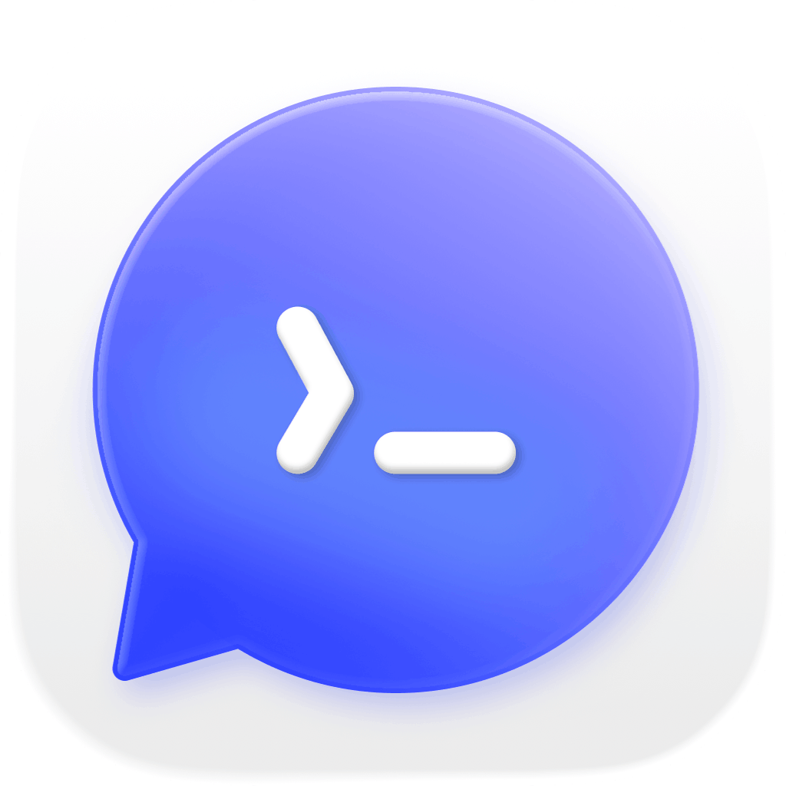
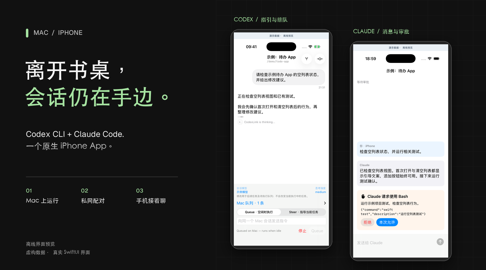
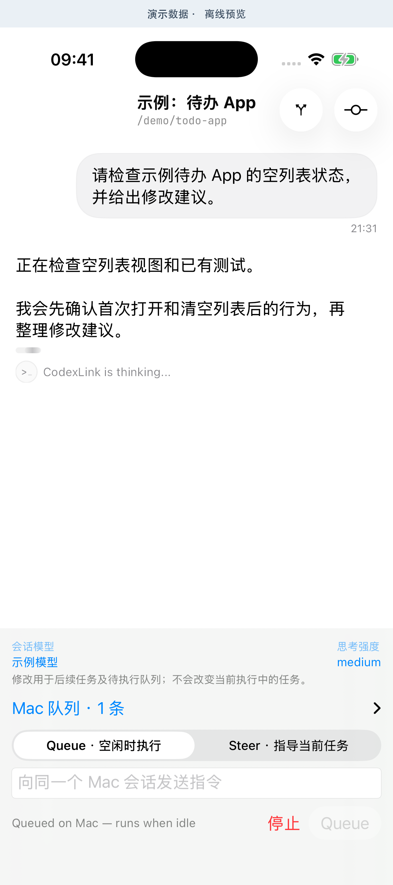
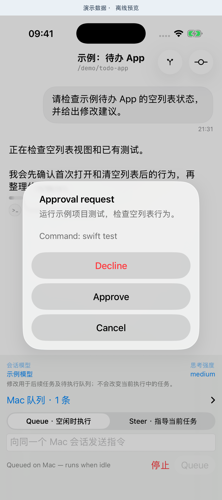
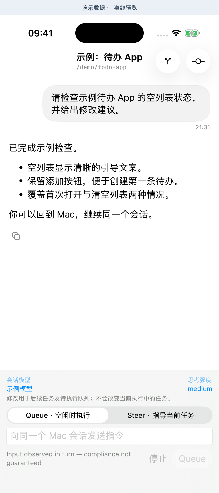
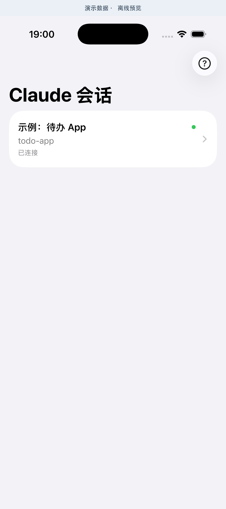
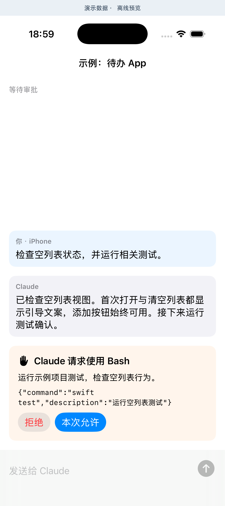
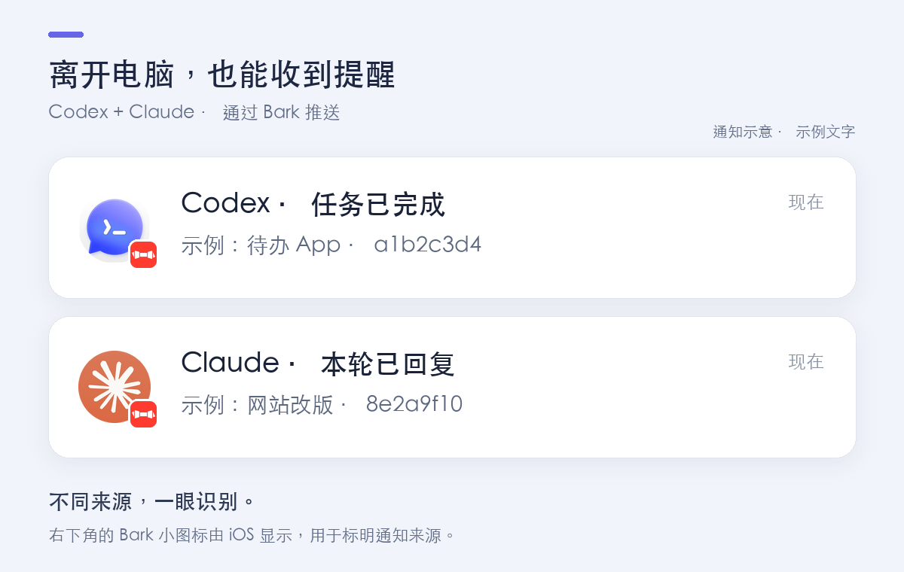

<div align="center">
  
  <h1>CodexLink</h1>
  <p><strong>Mac 继续工作，你随时接上对话。</strong></p>
  <p>在原生 iPhone App 中，连接 Mac 上的 Codex CLI 与 Claude Code。</p>
  <p><a href="README.md">English</a> · <strong>简体中文</strong></p>
  <p>
    <a href="docs/release-readiness.md"></a>
    
    <a href="LICENSE"></a>
  </p>
  <p>
    <a href="#features">功能亮点</a> ·
    <a href="#getting-started">开始安装</a> ·
    <a href="#project-docs">文档导航</a> ·
    <a href="CHANGELOG.md">更新日志</a>
  </p>
</div>

<p align="center">
  <a href="docs/images/readme-showcase.zh-CN.png"></a>
</p>

查看 Mac 上**正在执行的同一个 Codex 会话**，补充要求、安排下一条指令，或处理审批。启用可选的 Claude Channels 接入后，也能在同一个 App 中阅读 Claude 回复、继续对话。模型和工具始终在 Mac 上运行。

<a id="features"></a>

## 随手接上正在做的事

<table>
  <tr>
    <td width="50%" valign="top"><strong>同一个会话，两端接着用</strong><br />查看 Codex 实时输出，回到 Mac 后继续在原终端操作。</td>
    <td width="50%" valign="top"><strong>Codex 与 Claude，一个入口</strong><br />按项目找到会话，独立切换两种工具，保留草稿与阅读位置。</td>
  </tr>
  <tr>
    <td valign="top"><strong>补充当前任务，排好下一步</strong><br />Codex 的 Steer 指引当前任务，Queue 交给 Mac 持久排队，Stop 中断当前轮次。</td>
    <td valign="top"><strong>手机上也能好好阅读</strong><br />Markdown、代码高亮与清晰的强调色，让长回复更容易浏览。</td>
  </tr>
  <tr>
    <td valign="top"><strong>需要你决定时，查看请求</strong><br />在手机审阅工具请求；Codex 单次批准已真机验证，Claude 手机审批仍待验收。</td>
    <td valign="top"><strong>回复来了，锁屏就能知道</strong><br />可选 Bark 提醒，支持来源图标、会话标识与 Claude 任务短标题。</td>
  </tr>
</table>

**最近更新**：Claude 加载恢复、平级导航、草稿与回执保护，以及更接近 CLI 的文字配色。见[完整更新日志](CHANGELOG.md)。

> **Alpha / 开发者预览**：目前需从源码自行编译安装，适合愿意配置 Xcode 与私网连接的用户。本项目不是 OpenAI 或 Anthropic 官方客户端。

## 看看界面

封面与 App 截图使用真实 SwiftUI 界面和虚构离线数据，包括仍待真机验收的 Claude 审批界面；通知图片为效果示意。图片来源与复现方法见[图片说明](docs/images/README.md)。

<details>
<summary><strong>Codex：进行中的任务 → 审批 → 完成回复</strong></summary>

<p align="center">
  
  
  
</p>

从左到右：**运行中的会话与队列 → 审批请求 → 完成后的回复**。Steer 补充当前任务，Queue 留给下一轮；审批必须由用户明确处理。截图生成方式见 [图片说明](docs/images/README.md)。

</details>

<a id="claude-preview"></a>
<details>
<summary><strong>Claude：选择会话、阅读回复与查看请求</strong></summary>

<p align="center">
  
  
</p>

**选择会话 → 查看回复与工具请求。** 图片使用真实 SwiftUI 界面和虚构离线数据。手机消息收发已验证；审批图展示已实现的界面，手机审批的实际操作仍待验收。

</details>

<a id="notification-preview"></a>
<details>
<summary><strong>锁屏提醒：区分 Codex 与 Claude</strong></summary>

<p align="center">
  
</p>

**通知效果示意，使用虚构会话名称。** Codex 使用 CodexLink 图标，Claude 使用官方 Logo；右下角的小 Bark 图标是 iOS 显示的通知来源标识。会话名称和来源图标均为可选设置，配置方法见下方。

</details>

<a id="getting-started"></a>

## 安装前准备

准备一台可运行 Xcode 的 Mac、一部 iPhone，并在两端安装 Tailscale。模型沿用 Mac 上的账号；免费 Apple Personal Team 即可签名安装。

<details>
<summary><strong>查看版本要求与完整准备清单</strong></summary>

| 项目 | 要求 |
| --- | --- |
| Mac | 可运行 Xcode、Codex CLI 和 Tailscale；后台服务使用 macOS launchd |
| Codex | 已安装、已在 Mac 登录；当前验证基线为 **CLI 与 daemon 0.162.1** |
| Claude Code（可选） | 已在 Mac 安装并登录；当前实测 **2.1.300 + 官方 Pro 账号**，Channels 可用性受账号或组织策略限制 |
| Node.js | **推荐 Node 24**；Bridge 使用 `node:sqlite`，最低 22.13 |
| Xcode | 当前使用 **Xcode 26.5** 验证；其他版本未承诺兼容 |
| iPhone | App 最低 iOS 18.6；真机验证设备为 iPhone 16 Pro / iOS 18.7.8 |
| Apple 账号 | 免费 Personal Team 可自行签名安装；到期需重新签名安装，通常约 7 天 |
| 网络 | Mac 与 iPhone 安装 Tailscale，并加入可相互访问的同一 tailnet |
| 可选 | Bark 用于锁屏提醒；iTerm 用于“在 Mac 打开此会话” |

</details>

不提供本分支的 App Store / TestFlight 安装包。上游同名 App、npm 包不等同于本分支，请从此仓库构建 App 和 Bridge。Codex 调用仍使用你自己的账号与用量。

## 安装步骤

### 1. 获取源码与依赖

克隆本仓库：

```sh
git clone https://github.com/sky-story/CodexLink.git
cd CodexLink
npm --prefix codex-remote-bridge ci --ignore-scripts
npm --prefix relay ci --ignore-scripts
```

不要将新源码覆盖到已有配置目录。第一次打开 Xcode 工程时，还会自动解析项目声明的 Swift Package 依赖。

### 2. 确认共享 Codex daemon

先在 Mac 正常启动一次 `codex`，完成自己的登录。然后在项目目录运行：

```sh
node scripts/doctor.cjs
```

检查 CLI/daemon 版本、`daemonRunning` 和 `controlSocketPresent`。版本不匹配代表超出当前验证基线，不代表必然可用；不要为了安装本项目直接杀掉运行中的 daemon。

需要明确指定共享连接时，可在自己的项目目录启动：

```sh
codex --remote unix://
```

默认 socket 是 `~/.codex/app-server-control/app-server-control.sock`。Bridge 不会为接管失败的任务启动替代运行时。保持原来的审批和沙箱设置，不需要开启 Full Access。

### 3. 编译并安装 iPhone App

```sh
open CodexMobile/CodexMobile.xcodeproj
```

1. 在 Xcode 账号设置中添加自己的 Apple 账号。
2. 选择 **CodexMobile target → Signing & Capabilities**，启用自动签名，选择自己的 Team。
3. 将 Bundle Identifier 改为自己可注册的唯一值，例如 `com.example.mycodexremote`；不要直接沿用仓库维护者或上游的签名身份。
4. 连接并解锁 iPhone，按系统提示信任 Mac、开启开发者模式。
5. 选择 **CodexMobile scheme** 和自己的 iPhone，点击 Run。
6. 如果提示不受信任的开发者，在 iPhone「设置 → 通用 → VPN 与设备管理」中信任自己的开发签名。

免费签名不要求购买开发者账号；重新签名时尽量沿用自己的 Bundle ID 并覆盖安装，避免卸载丢失本地状态。暂不体验真机时可选 iPhone Simulator，但模拟器运行不代表锁屏推送通过。

完成首次安装后，日后更新代码或续签可连接并解锁手机，双击根目录的 **[更新 CodexLink.command](更新%20CodexLink.command)**。每次构建当前本地代码（包括未提交修改），不覆盖工作区、不复用旧安装包；显示真实签名到期时间并保留数据和配对。详见[更新工具说明](docs/setup.md#双击更新--免费签名续签)。

### 4. 启动 Mac 后台服务并配对

先让 Mac 与 iPhone 的 Tailscale 都在线，再在项目根目录运行：

```sh
node scripts/private-service.cjs start
node scripts/private-service.cjs status
```

首次启动通常会在 Mac 浏览器显示配对二维码。用 **CodexLink App 内的扫码入口**扫描，不要使用普通相机或在线二维码识别网站。

若需要重新显示二维码：

```sh
node scripts/private-service.cjs pair
```

成功配对后，选择 Mac 的测试会话，发送一条简单 Queue 验证。随后可在 Mac 执行稍长的安全任务，体验 Steer 和 Stop。

点击 **New Chat** 新建会话后，会询问是否在 Mac 新建 **iTerm** 窗口。“暂不”只保留手机会话；“打开 iTerm”打开同一个会话。空白会话会先显示等待提示，手机发送第一条消息后终端自动连接，最多等待 30 分钟，Ctrl+C 可取消。之后也可从会话菜单打开；Mac 可能需要允许自动化控制。

后台服务同时管理 Bridge 和 Relay，只监听 Tailscale 私网地址的 9100 端口。终端可关闭。不要再单独启动第二个 Bridge/Relay 抢占端口，也不需要公网端口映射。初次配对后，普通断网和 Bridge 重启不应要求反复扫码。

### 5. 可选：用 Bark 接收锁屏提醒

<details>
<summary><strong>配置 Bark、会话标识与通知图标</strong></summary>

1. iPhone 安装 [Bark](https://github.com/Finb/Bark)，允许通知和锁屏显示。
2. 从 Bark 首页复制自己的完整推送网址到 **Mac 剪贴板**，不要复制 `curl` 命令。
3. 在项目目录执行以下命令。网址从标准输入读取，不写入 shell 命令历史：

```sh
pbpaste | node scripts/bark-notifications.cjs --configure-stdin
node scripts/bark-notifications.cjs --status
node scripts/private-service.cjs restart
```

配置工具不会覆盖已有 Bark 接收设备配置。地址只保存在 `~/.codex-remote/bark-config.json`，权限为 600；不要把文件或设备 Key 提交到 Git。

锁屏后，可明确发送一条真实测试通知：

```sh
node scripts/bark-notifications.cjs --send-test
```

`accepted` 只说明 Bark 服务接受请求，仍需实际查看锁屏。通知来自 **Bark**，点击后需回到 CodexLink 处理审批。免费签名下这条路径可用；CodexLink 自有 APNs 推送尚未完成真机验收。

默认只发送固定通用提醒。多个会话同时运行时，可以开启会话标识：

```sh
node scripts/bark-notifications.cjs --session-labels on
node scripts/private-service.cjs restart
```

通知标题显示简短状态（如“Codex · 任务已完成”），正文显示“会话名称 · 短标识”，无名称时使用项目目录名；同名会话也使用不同短标识，并按会话分组。不会使用首条消息或回复预览作为会话名称。关闭时将 `on` 改为 `off` 并重启服务。

Bark 公共服务会收到设备 Key 和通知内容；开启会话标识后，还会收到会话名称（或项目目录名）与短标识。正文仅包含会话标识，不发送对话、命令、代码、完整路径或原始线程 ID。请避免给会话取包含敏感信息的名称。提醒可能受专注模式、通知摘要或网络影响，不是必达消息队列。

</details>

### 6. 可选：同时接收 Claude Code 通知

<details>
<summary><strong>安装 Claude 通知 Hooks 与可选任务短标题</strong></summary>

完成 Bark 配置后运行 `node scripts/claude-notifications.cjs install`，再新开 Claude 会话。安装器保留现有 Claude 设置和权限 Hooks。更新 Mac 服务后，Codex 与 Claude 的通知共用持久发送记录并分别标明来源。通知可独立使用；安装、卸载和限制见 [Claude 通知说明](docs/claude-notifications.md)。

可选图标：`node scripts/bark-notifications.cjs --icon codex default` 使用 CodexLink 图标，`--icon claude default` 使用官方 Claude Logo。修改后重启 Bridge；首次升级还需更新 Claude Hooks 并新开会话，旧窗口可能仍使用旧发送器。图片由手机下载并缓存，配置和预览方法见 [通知图标设置](docs/setup.md#分别显示-codexlink-和-claude-图标)。

要区分同名 Claude 窗口，可先开启会话标识，再运行 `node scripts/bark-notifications.cjs --claude-task-labels on`。此选项默认关闭，开启后会把当前指令的有限短片段发送给 Bark 并显示在锁屏；不是模型摘要。用 `off` 关闭，详见[任务短标题说明](docs/claude-notifications.md#用任务短标题区分多个窗口)。

</details>

### 7. 可选：在同一个 App 中操作 Claude

<details>
<summary><strong>用 clink 接入 Claude，查看常用命令与当前限制</strong></summary>

完成上面的 App、Bridge 和配对设置；如需锁屏提醒，也完成第 6 步。官方账号沿用 Mac 上 Claude Code 的登录，无需另外配置 API Key。

在本仓库根目录设置一次短命令：

```sh
chmod +x scripts/claude-session.cjs
mkdir -p "$HOME/.local/bin"
ln -s "$PWD/scripts/claude-session.cjs" "$HOME/.local/bin/clink"
```

确保 `~/.local/bin` 位于终端的 `PATH` 中；已有同名命令时请换一个名称。移动仓库后需要更新链接。具体设置见[短命令说明](docs/claude-sessions.md#可选使用短命令-clink)。

以后在你要工作的项目目录运行：

```sh
cd /path/to/your/project
clink                           # 新会话，默认以当前目录名命名
```

按 Claude 提示确认本地开发通道 **I am using this for local development**，完成项目/MCP 初始授权并保持终端打开。手机侧栏进入 **会话总览**，选择 Claude 会话即可发送消息并查看回复；右上角 **Claude 接入** 保留专用列表和接入说明。多个项目可分别开终端运行。

其他常用方式：

```sh
clink --name "我的项目"           # 新会话，自定义名称
clink --resume "完整的会话UUID"   # 在原项目目录恢复对话；先等原任务结束并退出原 CLI
clink --help
```

没有设置短命令时，也可运行 `node /path/to/CodexLink/scripts/claude-session.cjs`。

Claude 扩展的使用范围：

- **消息与通知**：手机消息进入 Mac 上同一个会话；本轮回复结束后可由 Bark 提醒。已接入的真机收发和普通 Claude 会话的自动锁屏提醒均已验证；提醒不表示所有后台任务都完成。
- **后台进度静默**：即使仍有后台任务或计划唤醒，主会话本轮回复结束也正常提醒。后台进度和子代理完成不单独触发回复提醒，同一轮重复 Stop 去重；审批、补充信息和 API 错误仍独立提醒。
- **已有窗口**：普通 `claude` 启动的会话不会自动出现在手机列表。当前没有自动发现或运行中挂接；已加载通知 Hooks 的普通会话仍可独立发送提醒。
- **关闭与恢复**：退出手机页面不终止 Mac 工作；退出 Mac CLI 后会话离线，历史仍保留。退出前可用 `/status` 查看 Session ID，再通过 `--resume` 恢复。不带 `--resume` 就新建会话。手机查看记录仍需连接 Mac 后台，暂不支持从手机启动已结束的会话或完整离线缓存。
- **模型与控制**：Claude 模型需在 Mac 用 `/model` 切换；手机暂不支持模型选择、Stop 或交互问答。一次性工具审批已实现，Mac 转发链路通过，手机审批及竞争/断线场景仍待验收。
- **上下文与配置**：通道会增加工具说明和回复工具调用的 token；本地同步本身不调用模型。只同步接入后的文字和最终回复，不导入旧 transcript 或提供完整工具日志。启动器仅接受 `--name`、`--resume`，原启动命令额外指定的模型、权限模式或提示词参数需另行核对。

Channels 属于官方研究预览。完整设置、数据存储和限制见 [Claude 会话接入](docs/claude-sessions.md)。

</details>

## 日常使用与更新

```sh
node scripts/private-service.cjs status     # 查看后台状态
node scripts/private-service.cjs restart    # 更新安装快照并重启 Bridge/Relay，保留配对
node scripts/private-service.cjs stop       # 停止服务；登录启动项仍保留
node scripts/private-service.cjs uninstall  # 停止并移除启动项，保留配对与历史
```

服务执行的是安装快照，修改 Bridge/Relay 后必须运行 `restart`。Swift 改动则需要重新编译、覆盖安装 App。以上命令不会重启整台 Mac 或杀掉 Codex daemon。

Mac 关机、睡眠或断网时无法实时控制。launchd 后台运行并不意味着 Mac 永不休眠。

## 工作方式

```text
Mac 原生 Codex TUI ──┐
                    ├── 同一个 Codex daemon / 同一个 Unix socket
Mac Bridge ─────────┘
    │
    ├── 本地 Channel / Hooks ⇄ Claude Code（可选）
    └── 私网 Relay ⇄ Tailscale ⇄ iPhone SwiftUI App
                  （配对后的消息端到端加密）

Codex 事件 / Claude Hooks ── 可选：事件提醒 / 会话标识 → Bark → iPhone 锁屏
```

<details>
<summary><strong>会话、模型设置与连接细节</strong></summary>

这里的 Turn 是一次任务执行：从用户发出任务到完成、失败或中断。Queue 通常产生后续 Turn；Steer 修改当前 Turn 的输入。

Codex 输入框上方显示会话的模型和思考强度，选项来自 Mac 返回的模型列表。修改用于后续任务及待执行的 Queue，不会切换当前正在执行的 Turn。配置由同一个 daemon 确认，保留原审批与沙箱策略；重连会刷新实际配置，结果不确定时不会自动重发。使用选择菜单需同时更新手机 App 与 Mac Bridge。

Codex 功能要求 CLI 和 Bridge 连接**同一个共享 daemon**。恢复历史记录、另起独立 App Server 或另一个 Codex 执行实例，不等于共享正在运行的任务。`--no-daemon` 会话不支持；部分 CLI `-c` 覆盖也可能切换到内嵌运行时。Claude 扩展使用官方 Channels 预览协议，需在启动 Claude 时接入。

手机与 Mac 无需在同一 Wi-Fi，也无需选择 Tailscale 出口节点。模型请求仍由 Mac 使用自己的账号和网络发出；手机无需安装 Claude App 或另外登录模型账号。

</details>

## 当前能做什么

真机结果与待验收事项分开记录；展开查看每项功能的验证范围。

<details>
<summary><strong>逐项功能与验证状态</strong></summary>

| 功能 | 当前验证情况 |
| --- | --- |
| 查看 Mac CLI 实时输出 | 实体 iPhone 通过，包括 Tailscale 蜂窝网络 |
| Steer：执行中补充要求 | 真机验证作用于原 Turn，没有另起任务 |
| Queue：当前任务后执行 | 真机空闲、忙时排队通过；队列由 Mac daemon 持久管理 |
| Codex 会话模型与思考强度 | 真实 daemon 隔离实验通过；用户已确认手机模型菜单可打开，手机修改后的任务配置仍待验收 |
| 远程审批 | 真机单次批准通过；拒绝、双端竞争与待审批重连仍待验收 |
| Stop | 真机确认原 Turn 中断；**可能保留已后台化的工具进程** |
| Mac 继续操作 | 手机控制后，原 Mac TUI 可继续输入 |
| 自动重连 | 一次 Wi-Fi → 蜂窝切换、一次 Bridge 崩溃恢复通过；非全部故障场景 |
| Bark 锁屏提醒 | 真机确认测试通知送达；后台任务完成自动发送通过，审批提醒真机待验收 |
| Claude + Codex 通知 | Claude 真实回复后的自动提醒已确认锁屏送达；双 CLI 同时完成及审批提醒待验收，见[安装说明](docs/claude-notifications.md) |
| Claude 会话和工具审批 | 已接入官方 Channels 预览协议；真机消息与同一 Mac 会话回复已验证，审批转发在 Mac 实测通过，手机审批待验收 |
| Codex + Claude 会话总览 | 按项目分组，优先显示待处理和完成未读会话；隔离模拟器验证通过，完整真机交互待验收 |
| 在 Mac 打开此会话（iTerm） | 已实现，受 macOS 自动化授权影响，完整真机链路待验收 |

公开验证摘要和已知问题见 [验证记录](docs/validation.md)，发布定位见 [发布准备](docs/release-readiness.md)。

项目维护：[更新日志](CHANGELOG.md) · [开发交接](docs/HANDOFF.md)。

</details>

## 常见问题

- **手机 Offline**：先检查 Tailscale、Mac 是否醒着、服务 `status` 和 daemon。不要先删除配对文件；已验证服务恢复后可自动重连。
- **端口被占用**：检查是否有旧前台 Bridge/Relay，仅停止自己确认的重复进程；不要同时启动两套服务。
- **能看历史但不能 Steer**：确认目标是同一 daemon 的活动会话，并且有运行中的 Turn。Steer 失败不会退化成新任务。
- **Stop 后仍有命令运行**：Stop 中断 Turn；Codex 已后台化的工具进程可能继续，需要在 Mac 检查。手机尚无独立后台终端管理入口。
- **回执 unknown / Delivery uncertain**：先检查会话历史。Bridge 为避免重复执行，不会自动补发结果不明的指令。
- **历史加载出现 `list_turns is not supported yet`**：新建会话已改用当前 daemon 支持的历史格式；之前创建的分页会话保留原样，仍可能报错。修复后真机界面待复测。
- **在 Mac 打开失败**：要求 iTerm、本机已加载线程和 macOS 自动化权限。该功能仍属实验性，不会重启 Codex.app。
- **Bark 没提醒**：检查 Bark 通知权限、专注模式和 Mac 联网，再运行显式测试；勿把 Key 发到公开 Issue。

更多网络、签名和 APNs 细节见 [配置说明](docs/setup.md)。

## 开发与验证

当前状态和完整单测命令见 [开发交接](docs/HANDOFF.md)。下面的无签名命令只检查编译；涉及 Keychain 的单元测试需要正常模拟器签名。

```sh
npm --prefix codex-remote-bridge test
npm --prefix relay test
xcodebuild -jobs 2 -project CodexMobile/CodexMobile.xcodeproj \
  -scheme CodexMobile -destination 'generic/platform=iOS Simulator' \
  -derivedDataPath .build/ios CODE_SIGNING_ALLOWED=NO build
```

Bridge 单元测试使用临时状态和模拟 Keychain。不要把真实配对目录传给测试。真机验收原始记录、实验脚本和旧截图仅保留在维护者本机，不随源码公开。真实模型实验必须使用隔离工作区，会产生相应账号用量。

复杂断网、强制关闭 App、睡眠唤醒、daemon 崩溃、双端审批竞争和长期运行仍待扩大验收。上游保留的图片、语音、Git、MCP 等界面不代表共享模式已支持全部功能。

<a id="project-docs"></a>

## 文档导航

| 想了解什么 | 从这里开始 |
| --- | --- |
| 安装、签名续期与网络配置 | [配置说明](docs/setup.md) |
| 在手机使用 Claude | [Claude 会话接入](docs/claude-sessions.md) |
| 通知、图标与任务短标题 | [Claude 通知说明](docs/claude-notifications.md) |
| 每次更新做了什么 | [更新日志](CHANGELOG.md) |
| 接着开发或排查问题 | [项目交接](docs/HANDOFF.md) |
| 已验证的能力与当前限制 | [验证记录](docs/validation.md) · [发布准备](docs/release-readiness.md) |

## 来源、许可证与隐私

基于 [RealDyllon/codex-remote](https://github.com/RealDyllon/codex-remote/tree/9a737fb) 构建，感谢上游项目。本分支沿用 ISC 许可证。

保留上游 ISC 版权及所有依赖许可，见 [LICENSE](LICENSE)、[第三方声明](THIRD_PARTY_NOTICES.md) 和 [技术来源](docs/research.md)。

Codex 和 Claude 登录凭据留在 Mac。配对二维码、设备私钥、Bark Key、APNs 密钥与本地日志不要公开上传。提交 Issue 时请先移除对话、用户名、路径、设备标识及任何凭据。当前没有自动上传诊断信息的功能。

本分支的隐私说明见 [隐私](docs/privacy.md)，支持与问题反馈请使用 [GitHub Issues](https://github.com/sky-story/CodexLink/issues)。App 显示名称为 CodexLink；源码目录和技术标识保留原名以维持兼容，共享模式能力以本 README 为准。
